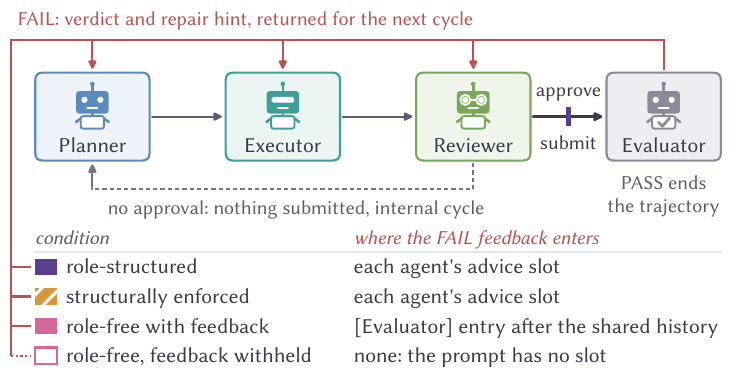

# Beyond Division of Labor: How Roles Shape Feedback and Recovery in Multi-Agent Systems

**Preprint · 2026**

[](https://chihhsuan-yang.github.io/AAMAS2027-AgentProtocols/)
[](https://chihhsuan-yang.github.io/AAMAS2027-AgentProtocols/paper.pdf)
[](https://chihhsuan-yang.github.io/AAMAS2027-AgentProtocols/supplement.pdf)
[](https://huggingface.co/datasets/AgentsSci/AAMAS2027-Roles)
[](LICENSE)

Chih-Hsuan Yang¹\*, Xinyang Li²\*, Rajeev Thakur¹, Feng Yan²<br>
¹ Argonne National Laboratory, Lemont, IL, USA  ·  ² University of Houston, Houston, TX, USA<br>
\* Equal contribution

---

**Roles govern decision rights and feedback access.** Roles allocate decisions as well as work. We compare a Planner–Executor–Reviewer team with and without role instructions, holding the agents, topology, call budget and ground-truth evaluator fixed. Removing roles largely eliminates specialization without lowering first-pass accuracy. After a failed answer, the role-free team recovers more often across five model–benchmark settings with feedback available to both teams. Submission logs show that the role-structured Reviewer often withholds approval, reducing opportunities for correction. In one exploratory intervention on 400 Omni-MATH problems with gemma-4, keeping the role prompts but forcing submission every cycle raises recovery from 0.198 to 0.613; the paired comparison detects no difference from the role-free team. The takeaway: evaluate who may submit, who receives feedback, and whether the team recovers—not just whether agents follow their roles. These findings concern systems with reliable external feedback.

<details>
<summary><b>Abstract</b></summary>

Roles in multi-agent large language model (LLM) systems allocate decisions as well as work. In a Planner–Executor–Reviewer team, the Reviewer's approval can determine when the team submits an answer and receives corrective feedback. We study both functions by varying role instructions while holding agents, topology, call budget, and ground-truth evaluator constant, using three open-weight models on Omni-MATH and two on SciBench. Removing roles largely eliminates functional specialization without lowering first-pass accuracy. After a failed first answer, however, submission decisions matter: a role-structured Reviewer often withholds approval, so its team submits less often and receives fewer evaluator verdicts. In an exploratory comparison with feedback available to both teams, the role-free team recovers more often across all five model–benchmark settings. Two further analyses support the importance of feedback opportunities. In a post hoc comparison at equal numbers of verdicts, the pooled recovery difference is small (role-structured minus role-free: +0.009, 95% interval [-0.014,+0.033]). In an exploratory intervention on 400 Omni-MATH problems with gemma-4, keeping the role prompts but forcing submission in every cycle raises recovery from 0.198 to 0.613; the paired comparison detects no difference from the role-free team. The takeaway is to evaluate roles through recovery after failure as well as specialization. For systems with reliable external feedback, this requires measuring who may submit, how often the team receives feedback, and which agents can act on it.

</details>


## Key finding

In the exploratory comparison where both teams receive feedback, on Omni-MATH
with gemma-4-31B-it the role-free team recovers **0.609** of its failed first
answers against **0.222** for the role-structured team. Of the 236 problems
both teams first answer wrongly, **89 are recovered only without roles and 4
only with them** (exact McNemar *p* = 6.2×10⁻²²), and final accuracy rises
from **0.846 to 0.921**. The role-free team recovers more in **all five**
actor–benchmark cells.

The difference tracks the submission gate. Per failed trajectory, the
role-structured team submits **1.27** times against **3.20**, and 84 of its
316 failed trajectories never submit at all. Matched on the number of
evaluator verdicts (post hoc), the pooled difference is **+0.009**, 95% CI
[−0.014, +0.033], which does not distinguish the two teams.

In a separate exploratory intervention, run only for gemma-4 on 400 Omni-MATH
problems, the role prompts are kept byte for byte but a submission is forced
every cycle: the role-structured team's recovery rises from **0.198 to
0.613**, against 0.549 for the role-free team with feedback on the same
problems. This run is not part of the five-cell comparison above.

Roles govern decision rights and information flow as well as work
allocation. Evaluating a multi-agent organization therefore requires looking
beyond role fidelity to its decision policy, feedback access and failure
recovery.

## Conditions

All conditions share three agents and one evaluator, the order
Planner → Executor → Reviewer, a grid of six deliberation cycles
(3 outer × 2 inner), a budget of 30 actor and 6 evaluator calls, temperature 0,
`max_tokens` 8192, one pinned vLLM server, and `gpt-oss-120b` as the
evaluator. A PASS ends the trajectory; a FAIL returns a verdict and a repair
hint.

| Condition | Prompts | Where FAIL feedback enters | Who approves submission | Code |
|---|---|---|---|:--:|
| **Role-structured** (RS) | Planner, Executor and Reviewer prompts | each role's advice slot | Reviewer | `A` |
| **Role-free, with feedback** (RF) — *main comparison* | one byte-identical generic prompt for all three agents | `[Evaluator]` entry after the shared history | third agent (`[Agree]`) | `Bf` |
| **Role-free, feedback withheld** (RF⁻) — *diagnostic* | same generic prompt | nowhere | third agent (`[Agree]`) | `B` |
| **Structurally enforced** | typed JSON contracts; the Planner schema has no answer field | each role's advice slot | Reviewer (`accept` promotes the Executor's answer) | `C` |
| **Context-restored enforced** | as enforced, plus the shared history | each role's advice slot | Reviewer | `Cp` |
| **Forced submission** — *exploratory* | RS prompts, byte for byte | each role's advice slot | none: submitted every cycle | `Afs` |

The paper uses the names; code and raw data use the codes.



**Actors:** `google/gemma-4-31B-it`, `openai/gpt-oss-120b`,
`meta-llama/Llama-3.3-70B-Instruct`. One model plays all three agents.
**Benchmarks:** Omni-MATH (1,600 problems sampled from 4,181; 400 for
Llama-3.3) and the complete 574-problem text-only free-response slice of
SciBench.

## Scope

| Cell | gemma-4 | gpt-oss | Llama-3.3 |
|---|:--:|:--:|:--:|
| Omni-MATH: RS, RF, RF⁻, enforced | 1,600 | 1,600 | 400 |
| Omni-MATH: context-restored enforced | 400 | 400 | — |
| Omni-MATH: forced submission | 400 | — | — |
| SciBench: RS, RF, RF⁻ | 574 | 574 | — |

The RS-versus-RF contrast was pre-registered as secondary; the
pre-registered primary endpoint is null and is reported in the supplement.
The evaluator, `gpt-oss-120b`, is also one of the actors. Each cell is one
realized run at temperature 0. The two gemma-4 RF cells were run twice, and
gemma-4's RS cell was re-run on 400 problems as a drift check; both are in
the supplement.

## Reproducing the paper

| Level | What it does | Command | Time | Needs |
|---|---|---|---|---|
| **A** | regenerate Table 2, the post-freeze supplement tables and every figure from the committed intermediate files | `make smoke`, `make figures` | ~1 min | CPU; nothing to download |
| **B** | re-derive every intermediate from the released trajectories and diff it against the committed record; regenerate every table | `make data numbers tables` | minutes | CPU; ~500 MB download |
| **C** | re-run inference | see below | hours | an OpenAI-compatible vLLM endpoint; does **not** reproduce the frozen numbers bit for bit |

Every analysis script is deterministic: bootstraps are seeded (`20261008`)
and every *p*-value is an exact McNemar test, so each `make` target ends in a
`git diff --exit-code` against the committed files and fails on any
difference. Level C is not deterministic: temperature-0 decoding on a shared
server is not bit-reproducible, which is why the sha256-manifested
trajectories are the record.

### Setup

```bash
git clone https://github.com/ChihHsuan-Yang/AAMAS2027-AgentProtocols.git
cd AAMAS2027-AgentProtocols
make setup                      # .venv with the pinned environment (Python 3.13)
```

Use `make setup PYTHON=/path/to/python3.13` if `python3` is another version.
Every other target runs inside `.venv`; nothing needs activating.

Figures are set in **Libertinus Sans**. `make figures` downloads it once
from the [Libertinus release](https://github.com/alerque/libertinus/releases)
into `.fonts/`; no TeX installation is needed. Run without the font, the
generators fall back to DejaVu Sans, which is wider: labels clip and
`mk_fig_pipeline.py` stops with `table too wide`.

### Level A: regenerate the paper's results (no download)

```bash
make smoke      # offline tests of the RF and forced-submission prompts (no model calls),
                # then Table 2 and Tables S3-S6 from analysis/out/; fails on any byte difference
make figures    # Figures 1, 2 and S1-S4 into paper/figures/
```

Tables regenerate byte for byte. Figures render pixel-identical to the
committed PDFs (checked at 200 dpi); their PDF bytes differ between runs, so
compare them by rendering, not with `git diff`.

### Level B: re-derive every number from the trajectories

```bash
make data       # download both datasets, find every pinned file by sha256, link it in place
make numbers    # FINAL_TABLES.py, bf_numbers.py (both RF runs), bf_gate.py -> analysis/out/
make tables     # every table, including Table 1 and the frozen-snapshot supplement tables
```

`make data` downloads two Hugging Face datasets: the trajectories
(`AgentsSci/AAMAS2027-Roles`) and the problem set with gold answers
(`AgentsSci/IEEE2026_BigData_MAS-4-Science-Matching`, `data/problems/` and
`data/trajectories/`). [`scripts/place_data.py`](scripts/place_data.py) then
locates each of the 14 trajectory files by the sha256 recorded in the
committed manifests, whatever its name or folder in the download, and links
it where the analysis reads it. It exits non-zero if anything is missing.
Data already on disk can be placed with
`python3 scripts/place_data.py --source <dir>`.

The trajectory dataset is at **v1.2.0** (Hub tag `v1.2.0`). The download is
checked by hash, not by version: if a later version changed any pinned file,
`make data` would stop instead of running the analysis on different data.

### Main results → command

| Paper item | Result | Generator | Target |
|---|---|---|---|
| Figure 1 | one cycle; feedback route per condition | `mk_fig_pipeline.py` | `make figures` |
| Table 1 | functional collapse per actor | `mk_tables.py` | `make tables` |
| Figure 2 | first pass, recovery, budget use | `mk_fig1_bf.py` | `make figures` |
| Table 2 | RS vs RF in all five cells | `mk_table_main.py` | `make smoke` |

Every supplement table and figure, with its input and data source, is in
[`docs/reproduction/paper_artifact_matrix.md`](docs/reproduction/paper_artifact_matrix.md).

Spot-check the first row of Table 2:

| gemma-4, Omni-MATH | RS | RF |
|---|:--:|:--:|
| recovery | 0.222 | 0.609 |
| recovered only by (paired, *n* = 236) | 4 | 89 |
| final accuracy | 0.846 | 0.921 |
| submissions per failed trajectory | 1.27 | 3.20 |

### Level C: re-run inference

```bash
python3 experiments/runner.py --dry-run --n 2 --arms A,B,Bf,C \
    --out /tmp/dry.jsonl                                          # stub model, zero API calls
bash experiments/run_bf.sh experiments/results/bf                 # post-freeze campaign (RF, RS re-run)
```

`run_bf.sh` takes the actor (`ACTOR`, `TAG`), problem count (`N_OMNI`) and
concurrency (`CONC`) from the environment, and requires
`AAMAS_PROBLEMS_PARQUET` and `AAMAS_AUTH_SCRIPT_DIR` even with `DRY=1`.
The design of the post-freeze RF condition, written before its data existed,
is [`experiments/BF_CONTROL.md`](experiments/BF_CONTROL.md).
The runners call the OpenAI-compatible vLLM gateway used for the paper
(`BASE_URL` in `experiments/runner.py` and `runner_xdomain.py`) with a bearer
token from the helper in `AAMAS_AUTH_SCRIPT_DIR`. To run against your own
server, point `BASE_URL` at it and supply a token helper. Every trajectory
records a `config_version` hash of the prompts, schemas and run constants,
`BASE_URL` included: the code in this repository reproduces the hashes
recorded for the forced-submission run (`1a5f4fe24f242c80`) and the SciBench
RF runs (`d311904cee36c21b`), and a changed endpoint yields a new hash, so
new runs are never pooled with the released ones by accident.

Problem manifests are deterministic and hash-verified
(`experiments/manifest_omnimath2_n1600.json`, `…_n400.json`). Each trajectory
is written as one fsync'd JSONL line; re-running the same command resumes and
skips completed `(problem_uid, arm, actor_model)` triples.

## What is released

- **Every trajectory** behind the paper, sha256-manifested: 11,600 frozen
  Omni-MATH and 2,296 frozen SciBench trajectories, with role messages,
  evaluator calls and enforcement events; the RF condition in all five cells
  (4,748), the gemma-4 RS re-run (400) and the forced-submission run (400); and
  the second gemma-4 RF run with its RS re-run (2,574). In 18 rows the `error`
  field held a response page returned by the inference gateway; the public
  files replace it with a fixed marker
  ([`scripts/redact_release.py`](scripts/redact_release.py)). No analysis reads
  that text, so every number is unchanged, and each manifest records the hash
  of the original file under `redacted_from_sha256`.
- **Prompts, schemas and run configurations** for every condition, including
  the domain-adapted SciBench prompts.
- **The collapse adjudication**: frozen rubric, sample, and verdicts
  ([`adjudication/`](adjudication/)).
- **The analysis code** that computes every number, the intermediate files it
  writes (`analysis/out/`), and the generators for every table and figure.
- **The LaTeX source** of the preprint, with every table and figure as generated.

## What is not released

- **SciBench problem text and answers.** Trajectory rows carry `problem_uid`,
  which joins to the public SciBench release. (The Omni-MATH-2 sample's text
  and reference answers are in the problem manifests; see [`NOTICE`](NOTICE).)
- **Token counts and cost.** They were never recorded; every budget in the
  paper is in calls and cycles.
- **Model weights.** All three actors are third-party open-weight models.
- **Repeated stochastic runs.** One realized trajectory per problem and cell,
  except the two gemma-4 RF cells.

## Repository layout

```
experiments/    runner, prompts, schemas, problem manifests, offline tests,
                and the sha256 manifests that pin every trajectory file
analysis/       FINAL_TABLES.py, bf_numbers.py, bf_gate.py, the table and
                figure generators, and their committed outputs in out/
adjudication/   collapse adjudication: rubric, sample, verdicts
paper/          LaTeX source of the preprint, generated tables and figures
scripts/        place_data.py: locate and link the downloaded data
docs/           artifact matrix and README figures
```

## Documentation

- [Paper artifact matrix](docs/reproduction/paper_artifact_matrix.md): every table and figure → generator → data
- [RF control design](experiments/BF_CONTROL.md): the post-freeze condition, written before its data existed
- [Table provenance](paper/tables/README.md): input, denominator and caveats of every generated table

## Citation

The canonical BibTeX entry is
[`citation.bib`](https://chihhsuan-yang.github.io/AAMAS2027-AgentProtocols/citation.bib)
on the project website and is reproduced below. GitHub's *Cite this
repository* button reads [`CITATION.cff`](CITATION.cff), which gives the same
title, authors and year.

```bibtex
@misc{yang2026beyond,
    title = {Beyond Division of Labor: How Roles Shape Feedback and Recovery in Multi-Agent Systems},
    author = {Yang, Chih-Hsuan and Li, Xinyang and Thakur, Rajeev and Yan, Feng},
    year = {2026},
    note = {Preprint},
    url = {https://chihhsuan-yang.github.io/AAMAS2027-AgentProtocols/}
}
```

## Acknowledgments

This research used resources of the Argonne Leadership Computing Facility, a
U.S. Department of Energy (DOE) Office of Science user facility at Argonne
National Laboratory (ANL) operated under Contract No. DE-AC02-06CH11357. The
work was also supported under the same contract by the DOE Office of Science's
Advanced Scientific Computing Research Program and by Laboratory Directed
Research and Development (LDRD) funding from ANL, provided by the Director,
DOE Office of Science. The work of the University of Houston coauthors was
supported in part by the National Science Foundation under grants
CAREER-2305491 and CNS-2504762.

We thank the authors of Omni-MATH and SciBench, whose benchmarks this study
measures against.

## License

Code and documentation in this repository are released under the [MIT License](LICENSE).
The [dataset](https://huggingface.co/datasets/AgentsSci/AAMAS2027-Roles) is not
covered by this licence; it keeps per-source terms, set out in its `LICENSES/`
folder: our derived material and the Omni-MATH-2 content are Apache-2.0, the
SciBench content is MIT, and model-generated text follows the model providers'
terms. Upstream benchmark content in this repository keeps its original terms;
see [`NOTICE`](NOTICE).

## Contact

Chih-Hsuan (Bella) Yang — bellayang@anl.gov
